

  <a href="https://dusttraildev-portfolio.animatedgull4.chatgpt.site">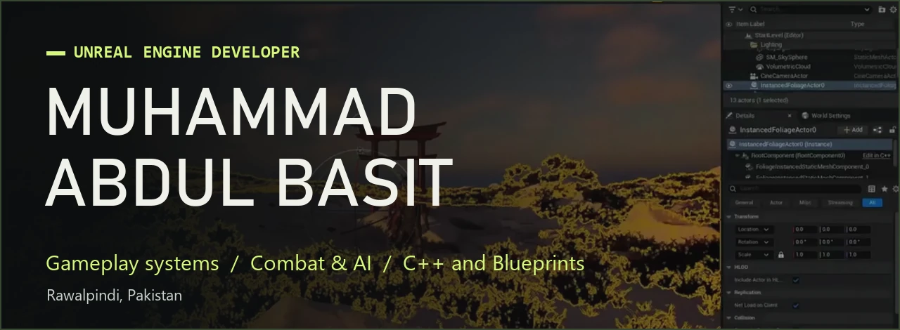</a>

  <a href="https://dusttraildev-portfolio.animatedgull4.chatgpt.site"><strong>View live portfolio ↗</strong></a> ·
  <a href="#project-footage">Project footage</a> ·
  <a href="#experience--skills">Experience</a> ·
  <a href="https://www.linkedin.com/in/muhammad-abdulbasit">LinkedIn</a> ·
  <a href="mailto:mbasitabbasi6@gmail.com">Email</a>

I build gameplay systems in Unreal Engine 5, with a focus on melee combat, enemy AI, and modular C++ and Blueprint architecture.

## Featured projects

- **BladeFall · Personal melee combat project** · I built C++ components for damage, combos, and difficulty scaling, with delegates connecting them. Designers can tune parry, block, dodge, posture, and stamina in the editor. Boss AI uses Behavior Trees and EQS to switch among patrol, alert, melee, ranged attack, cover, and retreat. Dismemberment provides visual feedback on kills.
- **Soulslike Combat Framework** · A reusable Unreal Engine combat framework with parry, block, dodge, posture, stamina, and executions. Difficulty settings drive enemy reactions. A walkthrough demo shows how to connect the components, Behavior Tree, and UI. [Fab listing](https://www.fab.com/listings/873ba41d-9900-4683-9fa3-5799bafd0d30)
- **Assassination System** · C++ stealth-takedown detection using airborne state, horizontal and vertical thresholds, and squared-distance checks. [Source](https://github.com/DustTrailDev/AssassinationSystem)
- **Basic Shooting** · Blueprint shooting and reload mechanics with integrated ad monetization. [Source](https://github.com/DustTrailDev/BasicShooting)

## Project footage

17 clips from Unreal Engine prototypes, technical demos, and playtests.

<table>
<tr>
<td width="33%"><a href="https://drive.google.com/drive/folders/1AHrJsqj8FFHPI_BNAQtYlu8xd54j5IzS">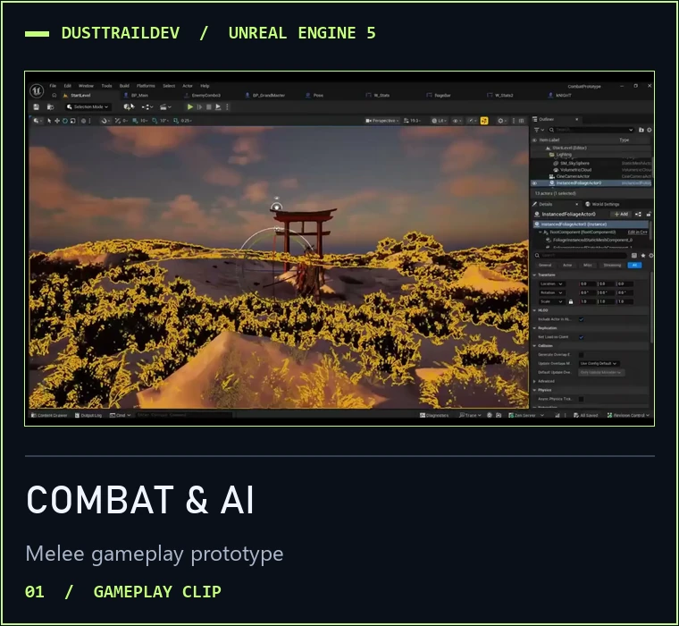</a> <a href="https://drive.google.com/drive/folders/1AHrJsqj8FFHPI_BNAQtYlu8xd54j5IzS">Open Drive folder ↗</a></td>
<td width="33%"><a href="https://drive.google.com/drive/folders/113X8xaqHDuP7hDhs53UQFwPgY0X03nCm">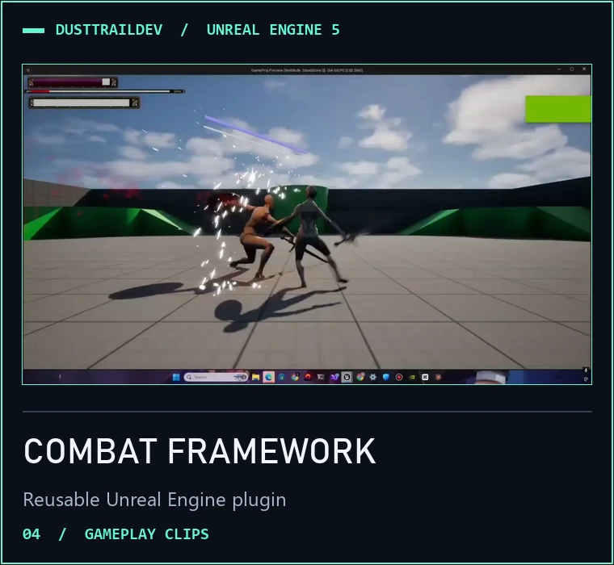</a> <a href="https://drive.google.com/drive/folders/113X8xaqHDuP7hDhs53UQFwPgY0X03nCm">Open Drive folder ↗</a></td>
<td width="33%"><a href="https://drive.google.com/drive/folders/1L_XTCqHKaDqosKFfv1sj1hUu31HKqhuS">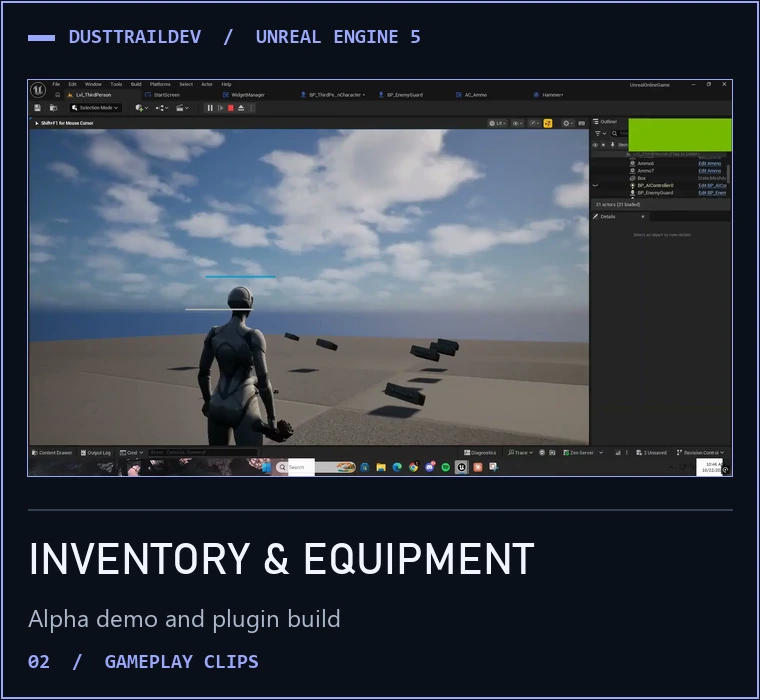</a> <a href="https://drive.google.com/drive/folders/1L_XTCqHKaDqosKFfv1sj1hUu31HKqhuS">Open Drive folder ↗</a></td>
</tr>
<tr>
<td width="33%"><a href="https://drive.google.com/drive/folders/1t9HMBZvh-4AkNMEKXIphbXK947qnYswD">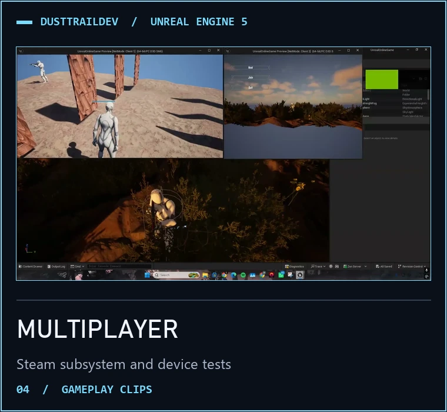</a> <a href="https://drive.google.com/drive/folders/1t9HMBZvh-4AkNMEKXIphbXK947qnYswD">Open Drive folder ↗</a></td>
<td width="33%"><a href="https://drive.google.com/drive/folders/1Tp5rH54VaG2DZsKndnwfmnilOjaCOWPg">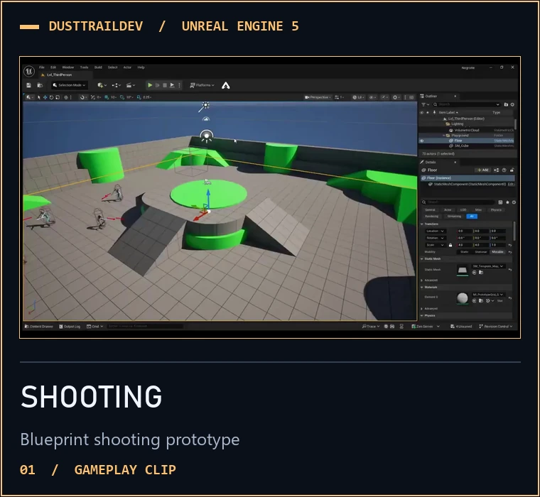</a> <a href="https://drive.google.com/drive/folders/1Tp5rH54VaG2DZsKndnwfmnilOjaCOWPg">Open Drive folder ↗</a></td>
<td width="33%"><a href="https://drive.google.com/drive/folders/1ZsjbddoJrkhEZAkajZiWpT-KutI1whYf">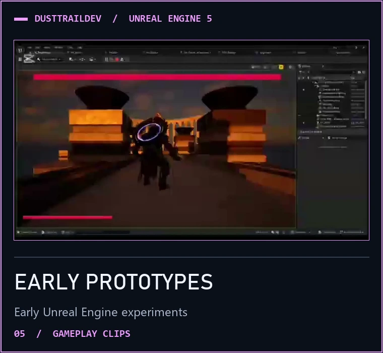</a> <a href="https://drive.google.com/drive/folders/1ZsjbddoJrkhEZAkajZiWpT-KutI1whYf">Open Drive folder ↗</a></td>
</tr>
</table>

<strong>Browse all 17 gameplay clips</strong>

### Combat & AI

[Open Drive folder](https://drive.google.com/drive/folders/1AHrJsqj8FFHPI_BNAQtYlu8xd54j5IzS)

[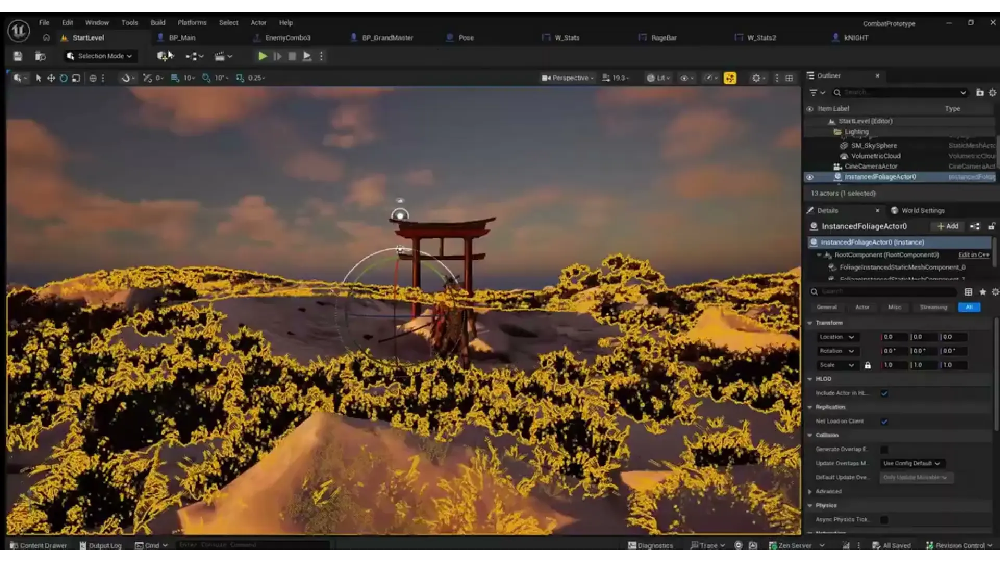](https://drive.google.com/file/d/1kdqiL0BHgQLh7vpSbaMtJk6E_owG6uAR/view)

**Samurai Game Prototype** · A samurai action prototype from my melee combat development work. [Watch video](https://drive.google.com/file/d/1kdqiL0BHgQLh7vpSbaMtJk6E_owG6uAR/view)

### Combat Framework Plugin

[Open Drive folder](https://drive.google.com/drive/folders/113X8xaqHDuP7hDhs53UQFwPgY0X03nCm)

[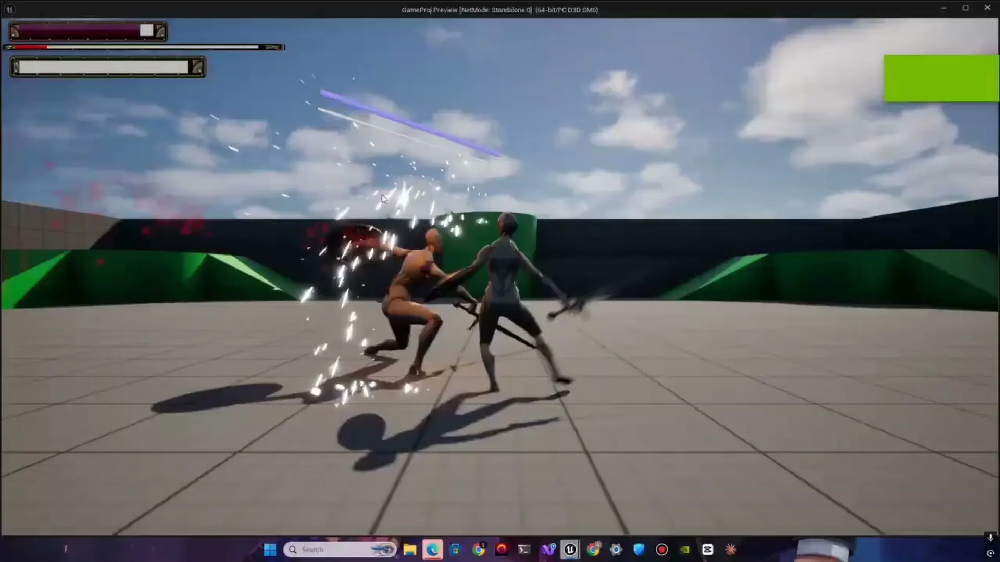](https://drive.google.com/file/d/1O8v6sJ7kCq0IAf1FXmXUlZ31ey66Bh16/view)

**Combat Framework · Exhibit A** · First demonstration of the modular combat framework. [Watch video](https://drive.google.com/file/d/1O8v6sJ7kCq0IAf1FXmXUlZ31ey66Bh16/view)

[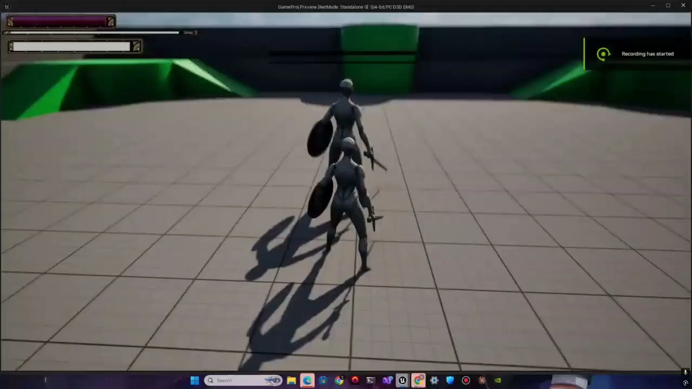](https://drive.google.com/file/d/1YDUjC1qedDF_4ZwTydu_Qjj9nAs1BcQL/view)

**Combat Framework · Exhibit B** · Second demonstration from the combat framework demo project. [Watch video](https://drive.google.com/file/d/1YDUjC1qedDF_4ZwTydu_Qjj9nAs1BcQL/view)

[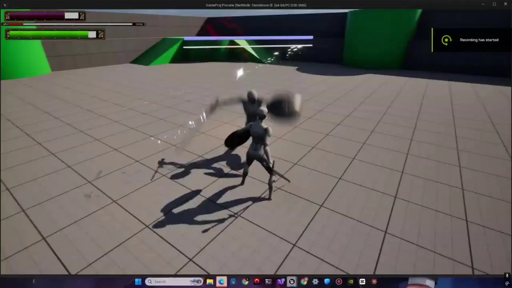](https://drive.google.com/file/d/1n8V4zTjHSdAsaGa3ntvRJqy9pL7QnE-J/view)

**Combat Framework · Exhibit C** · Third demonstration from the combat framework demo project. [Watch video](https://drive.google.com/file/d/1n8V4zTjHSdAsaGa3ntvRJqy9pL7QnE-J/view)

[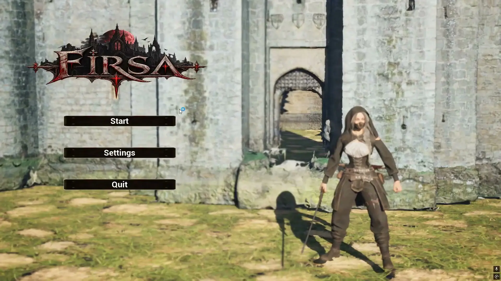](https://drive.google.com/file/d/1mwtG4bBq6OzcjDvF5uY7HTlPzaUkLk4V/view)

**Combat Framework · Testing** · Development footage from testing the framework. [Watch video](https://drive.google.com/file/d/1mwtG4bBq6OzcjDvF5uY7HTlPzaUkLk4V/view)

### Inventory & Equipment

[Open Drive folder](https://drive.google.com/drive/folders/1L_XTCqHKaDqosKFfv1sj1hUu31HKqhuS)

[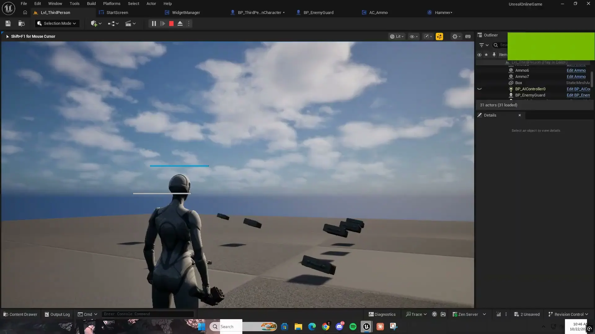](https://drive.google.com/file/d/1LaWZ42aIVNqUKn2d4YbJlxESvUlt7lxY/view)

**Inventory System · Alpha** · An early walkthrough of the standalone inventory and equipment system. [Watch video](https://drive.google.com/file/d/1LaWZ42aIVNqUKn2d4YbJlxESvUlt7lxY/view)

[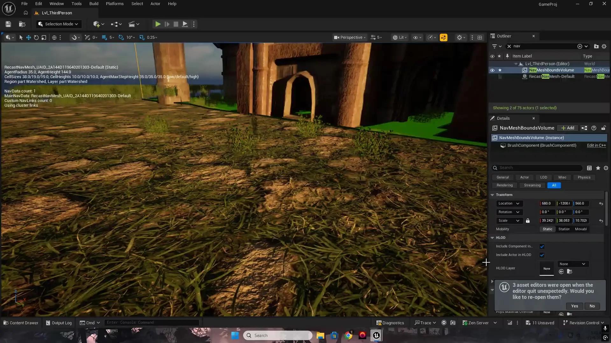](https://drive.google.com/file/d/1IiCJ1HZU3h_tr14BqRHttmd_xrH2lAk2/view)

**Plugin-Based Inventory** · A demonstration of the inventory system built using plugins. [Watch video](https://drive.google.com/file/d/1IiCJ1HZU3h_tr14BqRHttmd_xrH2lAk2/view)

### Multiplayer

[Open Drive folder](https://drive.google.com/drive/folders/1t9HMBZvh-4AkNMEKXIphbXK947qnYswD)

[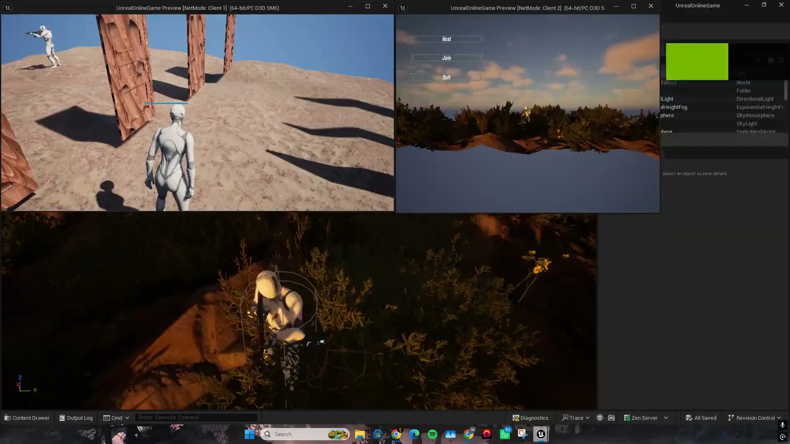](https://drive.google.com/file/d/1LFqtN63NAKZ_SGcgrgk2M8yUBMy2X5yX/view)

**Multiplayer Inventory & Shooting** · Inventory and shooting in a multiplayer prototype using the Steam subsystem. [Watch video](https://drive.google.com/file/d/1LFqtN63NAKZ_SGcgrgk2M8yUBMy2X5yX/view)

[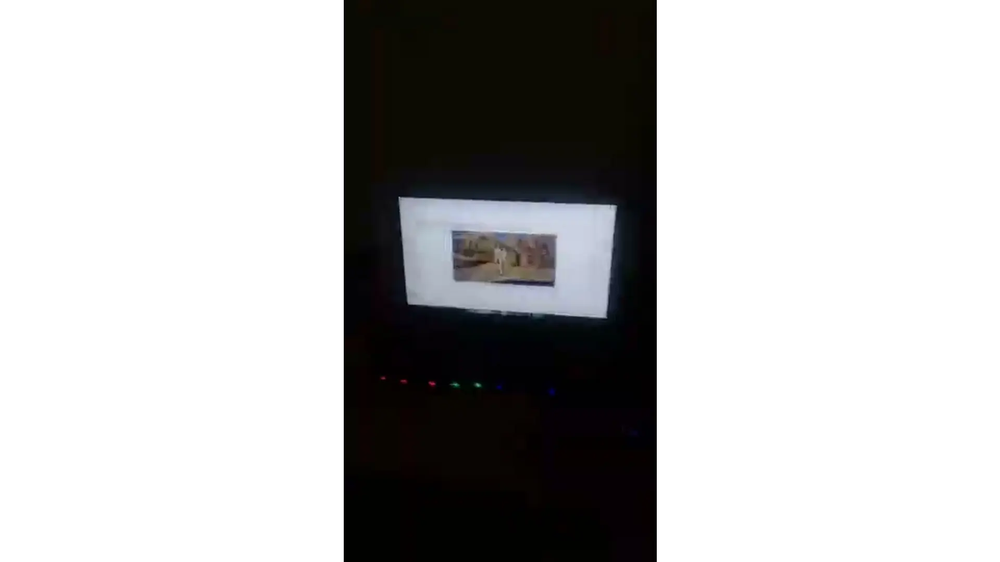](https://drive.google.com/file/d/1gyRITyEwMKSXQ0D_pXi9COWUOO8Hewjm/view)

**Two-Device Multiplayer Test** · A multiplayer test conducted across two devices. [Watch video](https://drive.google.com/file/d/1gyRITyEwMKSXQ0D_pXi9COWUOO8Hewjm/view)

[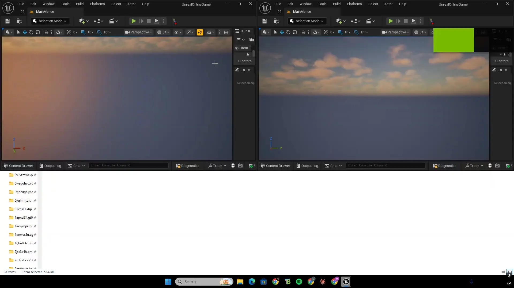](https://drive.google.com/file/d/1HzHjvLT_jNNzHibhRLtYLwhtFxg9OaGX/view)

**Online Subsystem · Iteration 3** · Third recorded iteration of multiplayer subsystem testing. [Watch video](https://drive.google.com/file/d/1HzHjvLT_jNNzHibhRLtYLwhtFxg9OaGX/view)

[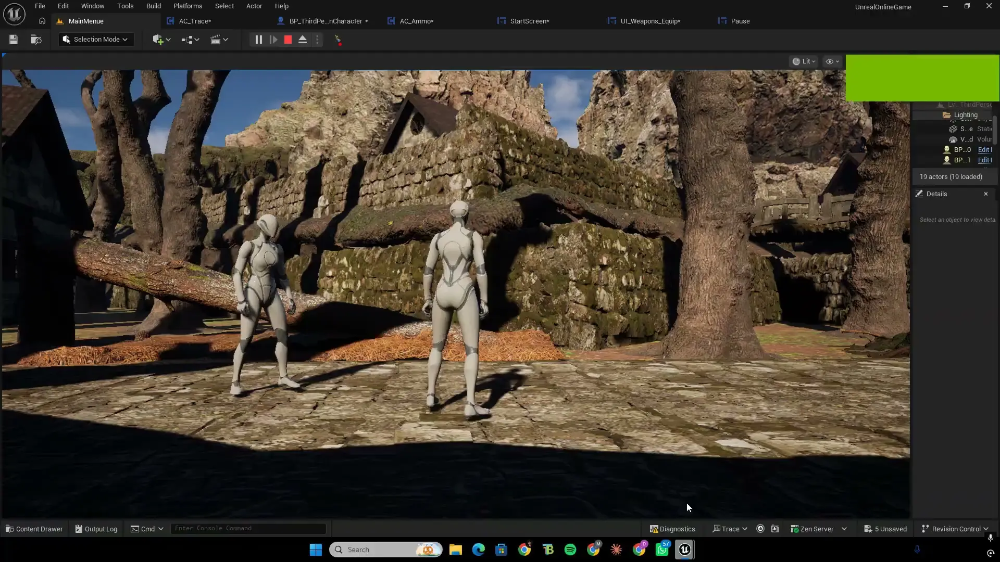](https://drive.google.com/file/d/1ySTDcGp1QrKchzSbIJghldKZ9qmhYE8o/view)

**Online Subsystem · Iteration 2** · Second recorded iteration of the multiplayer prototype. [Watch video](https://drive.google.com/file/d/1ySTDcGp1QrKchzSbIJghldKZ9qmhYE8o/view)

### Shooting

[Open Drive folder](https://drive.google.com/drive/folders/1Tp5rH54VaG2DZsKndnwfmnilOjaCOWPg)

[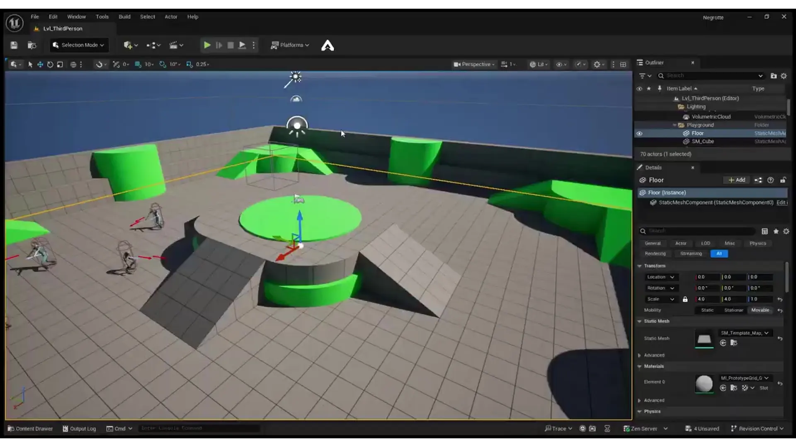](https://drive.google.com/file/d/1_wQZ-W_ZNv2WDkuXAQAdGugkSWMM1PFv/view)

**Basic Shooting Prototype** · A Blueprint prototype with shooting, reload logic, and integrated ad monetization. [Watch video](https://drive.google.com/file/d/1_wQZ-W_ZNv2WDkuXAQAdGugkSWMM1PFv/view)

### Early Prototypes

[Open Drive folder](https://drive.google.com/drive/folders/1ZsjbddoJrkhEZAkajZiWpT-KutI1whYf)

[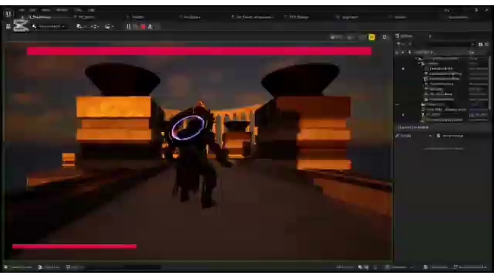](https://drive.google.com/file/d/1hsuWPETusuB6577AmfH365qB0G1cfWki/view)

**First Combat Prototype** · An early combat experiment from my Unreal Engine project archive. [Watch video](https://drive.google.com/file/d/1hsuWPETusuB6577AmfH365qB0G1cfWki/view)

[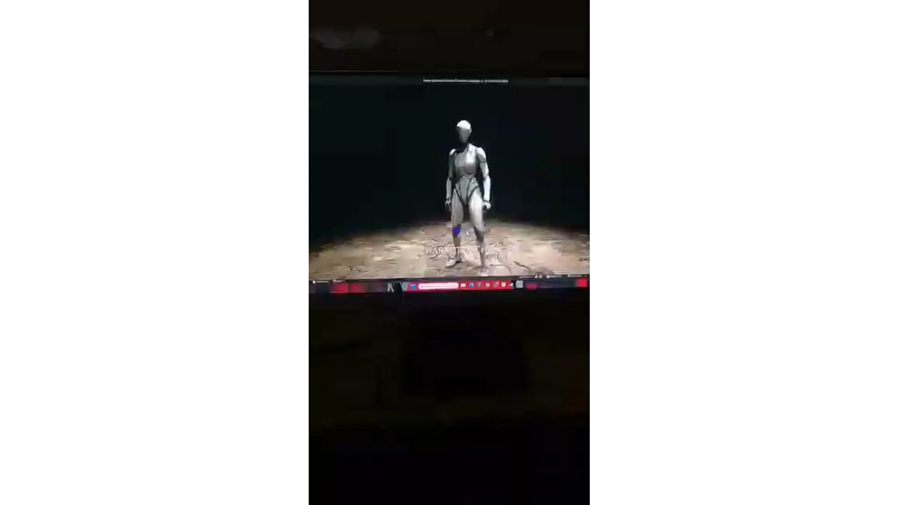](https://drive.google.com/file/d/1MkJN9z3X5Dqmz9gAo3chRKlYksRor53u/view)

**Early Prototype 1** · An early Unreal Engine prototype from my development archive. [Watch video](https://drive.google.com/file/d/1MkJN9z3X5Dqmz9gAo3chRKlYksRor53u/view)

[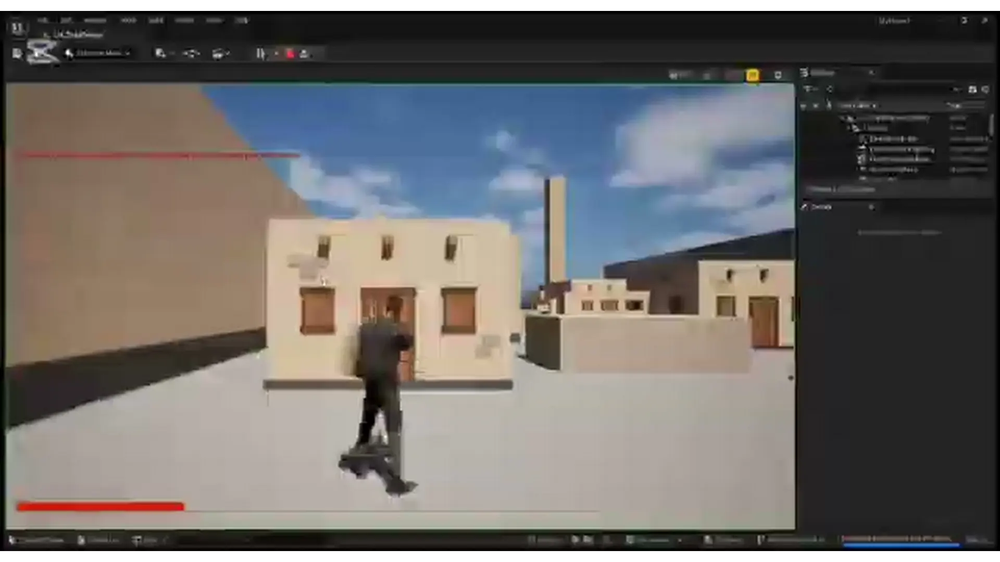](https://drive.google.com/file/d/1w6waElzMkj4EKUpga7Sq7bV4D1uF40uX/view)

**Early Prototype 2** · My second recorded prototype in the early project collection. [Watch video](https://drive.google.com/file/d/1w6waElzMkj4EKUpga7Sq7bV4D1uF40uX/view)

[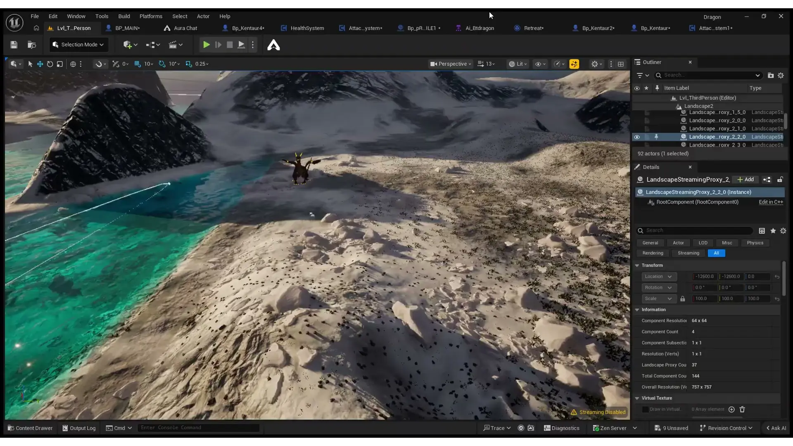](https://drive.google.com/file/d/1KHn1UhZNw0G00lJdF-r02cX4vU30KbFX/view)

**Early Prototype 4** · A prototype walkthrough from my early Unreal Engine work. [Watch video](https://drive.google.com/file/d/1KHn1UhZNw0G00lJdF-r02cX4vU30KbFX/view)

[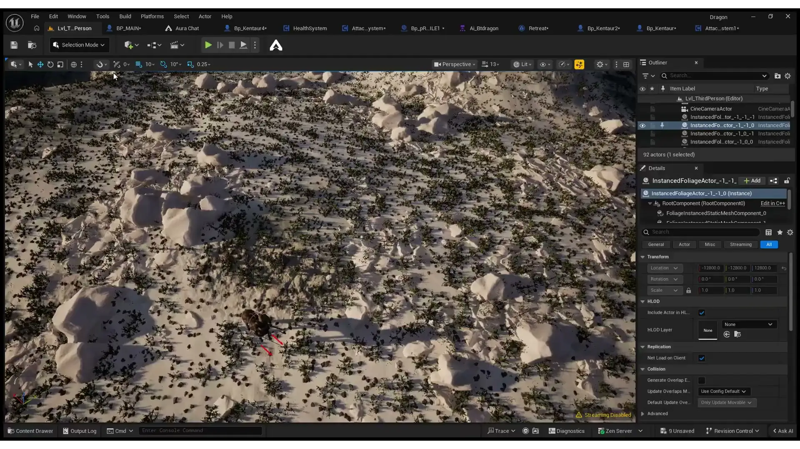](https://drive.google.com/file/d/1Vk6yPintyee20Rm1ETKHhroi-Nc3NeXM/view)

**Early Prototype 5** · A later entry in my early Unreal Engine prototype collection. [Watch video](https://drive.google.com/file/d/1Vk6yPintyee20Rm1ETKHhroi-Nc3NeXM/view)

## Experience & skills
- **Indigo Studios** · Current
- **Arcadym Studios** · Unreal Engine Developer Intern · February 2026–present · Islamabad. Built a modular Blueprint architecture and a data-driven inventory and equipment system using DataTables and primary asset IDs. Developed a physics-based Jenga simulation with a custom block-extraction interaction. Profiled and fixed gameplay performance issues found in cross-platform testing.

## Technical skills

- **Engine and programming** · Unreal Engine 5, C++, Blueprints
- **Gameplay and AI** · Behavior Trees, EQS, parry/block/counter/dodge, physics simulation, inventory, DataTables
- **Tools** · Git, GitHub, JetBrains Rider
- **Design** · Level design, environment art, gameplay UI and UX implementation

## Education

**BS in Game Development** · Air University, Islamabad · In progress

Relevant coursework includes game development, data structures and algorithms, object-oriented programming, and AI systems.

## Get in touch

[Email](mailto:mbasitabbasi6@gmail.com) · [LinkedIn](https://www.linkedin.com/in/muhammad-abdulbasit) · [GitHub](https://github.com/DustTrailDev)
